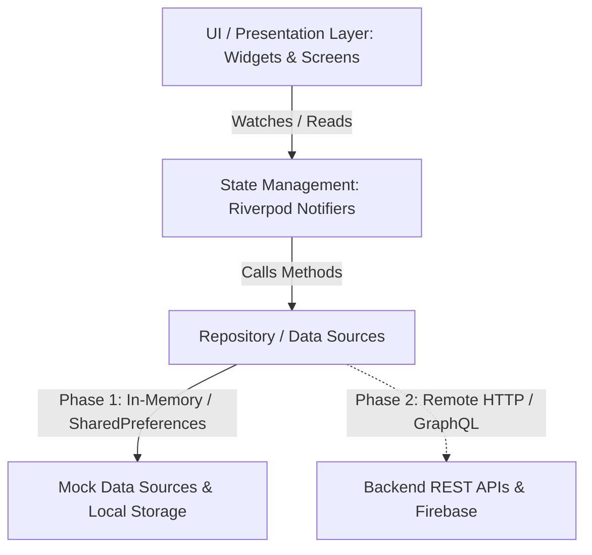

# 🏛️ Architecture Documentation (Mosque Finder)

## 1. Architectural Pattern: Clean Layered Architecture + Riverpod

Mosque Finder follows a modular, feature-first structure with clean separation between the Presentation Layer, Domain/State Layer, and Data Access Layer.



---

## 2. Layer Definitions

### A. Presentation Layer (`lib/features/*` and `lib/shared/*`)
- **Widgets:** Pure presentation components. Widgets **never** instantiate data sources or perform raw HTTP requests directly.
- **ConsumerWidget / ConsumerStatefulWidget:** Subscribes to Riverpod providers. Reacts reactively to state transitions (e.g. search queries, filter selection, radius expansion, dark mode, language changes).
- **Navigation:** Powered by `go_router` using a `ShellRoute` that persists the bottom navigation bar across top-level screens while allowing deep-linking into full-screen routes like `/mosque/:id`.

### B. State Management Layer (`lib/features/*/providers/`)
- **Riverpod 2.x Notifiers:**
  - `SettingsNotifier` (`AppSettings`): Controls app theme, language (Arabic/English), search radius, contributor identity, and notification preferences. Persists automatically to `SharedPreferences`.
  - `NearbyNotifier` (`NearbyState`): Controls mosque filtering, live text search, dynamic radius calculations, status chips (verified, unverified, flagged), and view states (list, empty, location permission).
  - `HomeNotifier` (`HomeState`): Controls active map selection, pin tap interactions, and radius ring boundaries.
  - `CommunityNotifier` (`CommunityState`): Manages crowd-sourced activity feed, mosque submissions, confirmations, and reports.

### C. Data Access Layer (`lib/data/`)
- **Models (`lib/data/models/`):** Strongly typed immutable data structures (`MosqueModel`, `MosqueFacilities`, `PrayerTimes`, `IqamaTimes`, `CommunityActivity`, `AppSettings`).
- **Data Sources (`lib/data/datasources/`):**
  - `MockMosqueDataSource`: Encapsulates 10+ realistic Egyptian mosques with exact coordinates, status badges, facilities, and prayer/iqama schedules.
  - `MockCommunityDataSource`: Encapsulates verified community actions, timestamps, and contributor activity.
  - `SettingsLocalDataSource`: Manages persistent local key-value storage using `SharedPreferences`.

---

## 3. Directory Layout

```
lib/
├── core/
│   ├── animations/       # AppAnimations, PulseWidget
│   ├── constants/        # AppColors, AppSpacing, AppTypography
│   ├── routing/          # AppRouter with GoRouter & ShellRoute
│   ├── theme/            # AppTheme (Light & Dark)
│   └── utils/            # QiblaUtils (Haversine & Forward Azimuth math)
├── data/
│   ├── datasources/
│   │   ├── local/        # Mock datasources & SharedPreferences
│   │   └── remote/       # Contract placeholders for Phase 2
│   └── models/           # MosqueModel, CommunityActivity, AppSettings
├── features/
│   ├── community/        # Community screen, feed, & contribution modals
│   ├── home/             # Map screen, custom canvas painter, preview cards
│   ├── mosque_detail/    # Mosque details, facilities, daily prayer tables
│   ├── nearby/           # Search list, filter bar, radius chips
│   ├── qibla/            # Compass widget & orientation simulator
│   ├── settings/         # Preferences, language flip, notifications
│   ├── shell/            # 5-tab persistent bottom navigation bar
│   └── splash/           # Animated logo intro & branding
├── shared/
│   └── widgets/          # StatusBadge, MosqueFinderAppBar, Toast, EmptyState
└── main.dart             # Root ProviderScope & MaterialApp.router
```

---

## 4. Internationalization & Bidirectional Layouts (RTL / LTR)

- The application is **Arabic-first**. When Arabic is selected:
  - TextDirection is forced to `TextDirection.rtl`.
  - Navigation icons (chevrons, arrows) automatically mirror.
  - Spacing and card alignments adhere to Arabic reading patterns.
- When toggled to English in Settings:
  - TextDirection dynamically flips to `TextDirection.ltr`.
  - Fonts and text styles adapt smoothly without application restart.

---

## 5. Security & Privacy Highlights

- **Zero Sign-In Requirement:** The app can be fully utilized anonymously.
- **No Private Data Stored:** Only preferences and contributor pseudonyms are stored locally on the client device.
